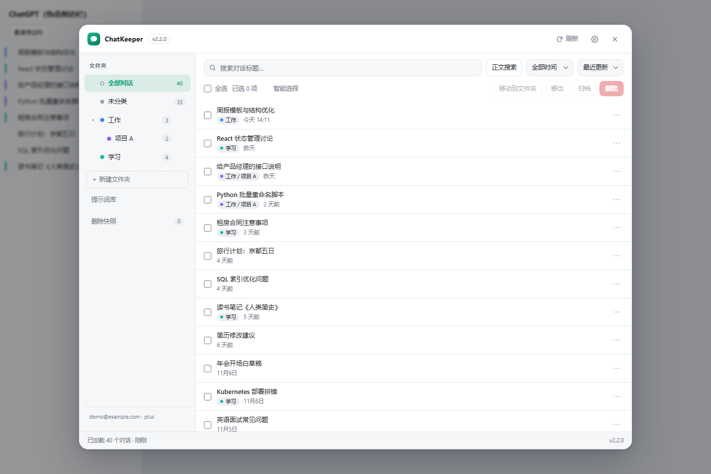
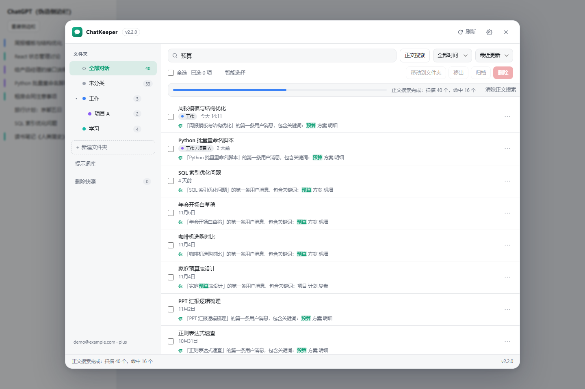
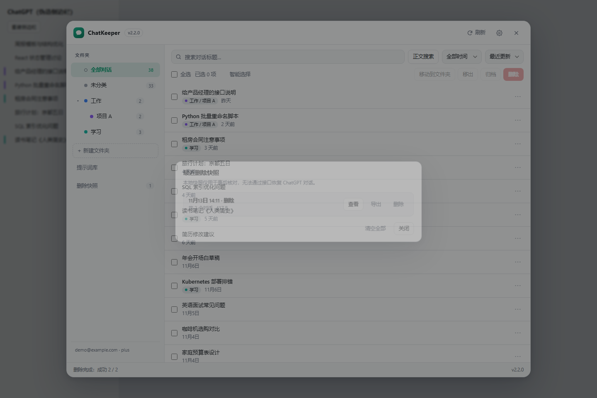
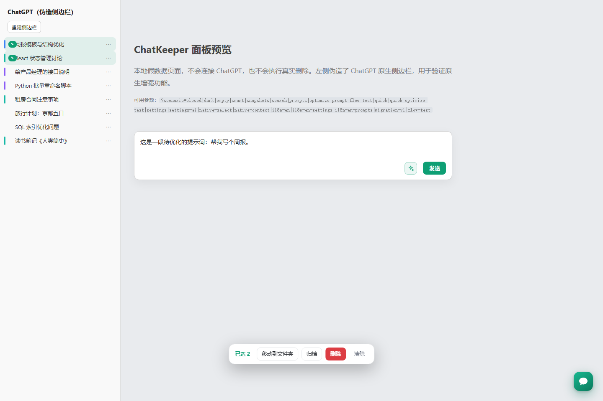
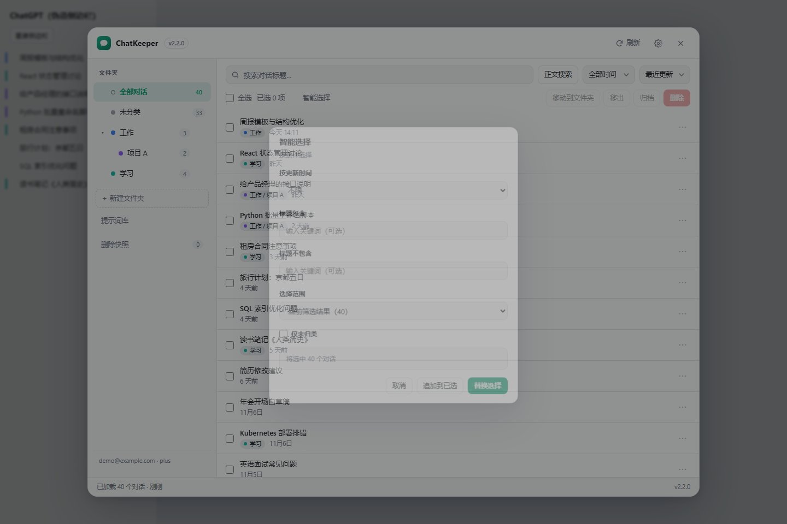
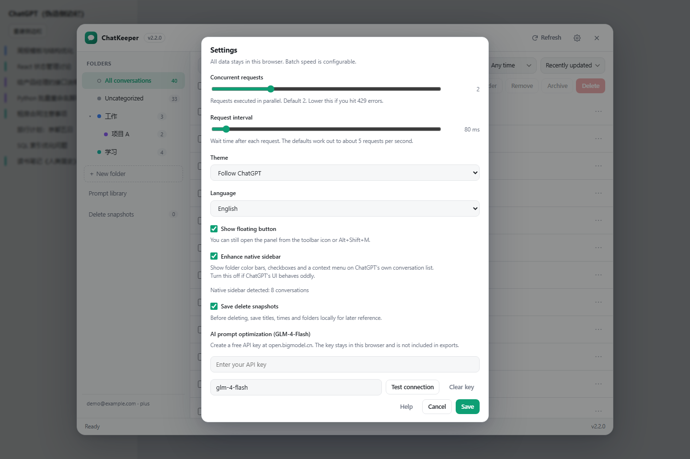
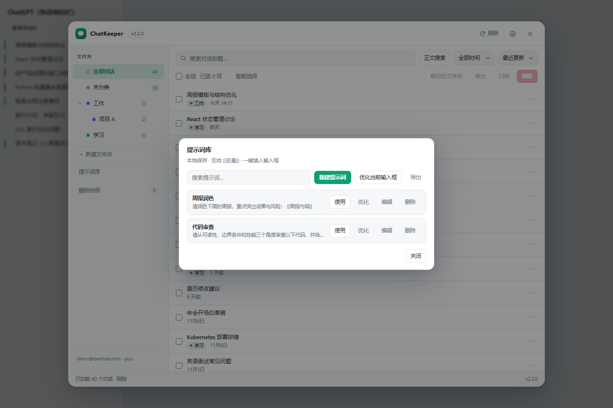
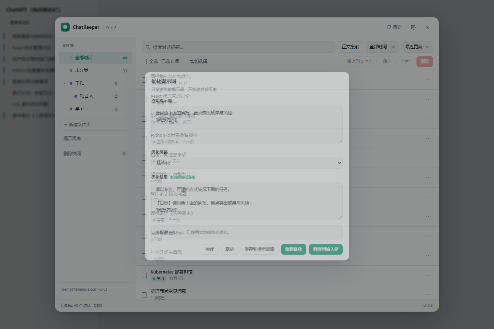
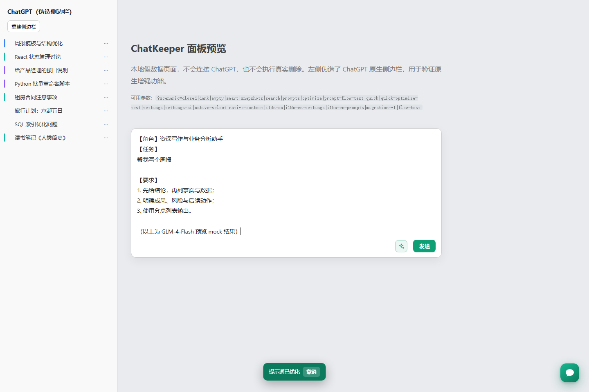
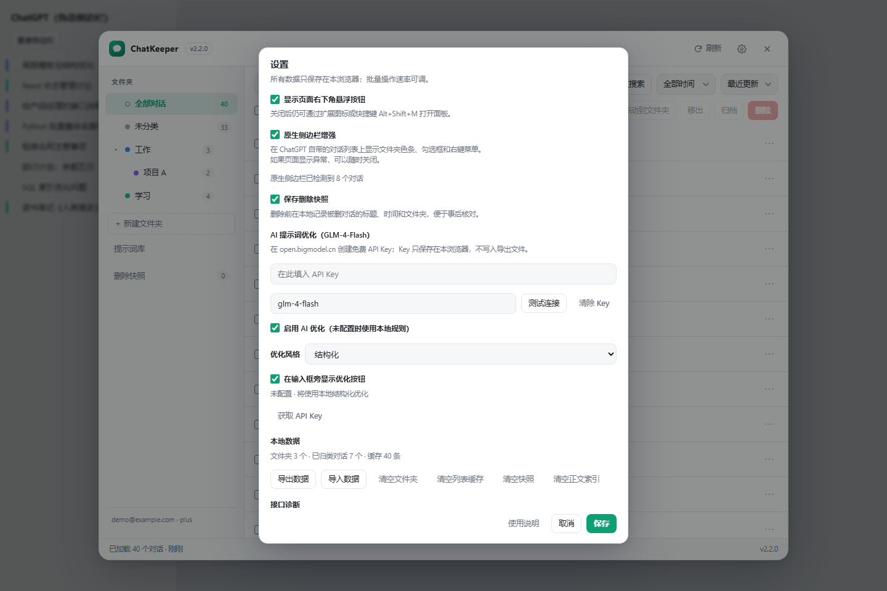

# ChatKeeper

**ChatGPT 对话批量删除 / 归档 · 递归文件夹 · 正文搜索 · 删除快照 · 提示词库与一键优化 · 中英双语**

<p>
  
  
  
</p>

GitHub：<https://github.com/fengyuzxl/chatkeeper>

一个轻量级 Chrome 扩展（Manifest V3），为 `chatgpt.com` 增加对话管理与提示词效率能力。可以一次删除几十上百条对话，像整理文件一样给对话分类，在正文里搜索，在删除前留下本地台账，并用提示词模板 / GLM-4-Flash 一键优化提示词。所有整理数据只保存在本机。

*A lightweight Chrome extension for bulk-deleting/archiving ChatGPT conversations, organizing them into recursive local folders, searching chat text, keeping local delete snapshots, and managing/optimizing prompts with an optional GLM-4-Flash API key. Data stays in your browser.*

> **ChatKeeper（原名 GPT Master）** 是独立实现，与 OpenAI 官方、Chrome 应用商店中的 GPT Master 扩展均无任何关联。请仅用于整理自己的账号对话。



---

## 目录

- [功能一览](#功能一览)
- [截图](#截图)
- [环境要求](#环境要求)
- [安装](#安装)
- [快速上手](#快速上手)
- [使用指南](#使用指南)
- [设置项](#设置项)
- [工作原理](#工作原理)
- [数据与隐私](#数据与隐私)
- [常见问题](#常见问题)
- [开发与测试](#开发与测试)
- [项目结构](#项目结构)
- [已知限制](#已知限制)
- [更新日志](#更新日志)
- [贡献](#贡献)
- [许可证](#许可证)
- [免责声明](#免责声明)

---

## 功能一览

### 批量删除 / 归档

- 勾选、点击整行、表头全选当前筛选结果
- 删除前二次确认，展示将删除的对话标题
- 实时进度、成功/失败计数、随时取消
- 失败清单 + 一键重试
- 删除与网页端「删除对话」使用同一接口，效果等同，速度快得多
- 归档独立于删除，之后仍可恢复

### 递归文件夹

- 自定义名称与颜色，支持多层子文件夹（最多 5 层）
- 拖拽对话到文件夹，或拖拽文件夹嵌套到另一个文件夹
- 菜单上移/下移排序
- 父文件夹计数包含所有子文件夹，点击父级显示其下全部对话
- 删除文件夹只清除本地归类：子文件夹提升到上一级，直接对话回到「未分类」，**不删除任何 ChatGPT 对话**

### 智能选择

- 按「超过 N 天未更新」
- 按标题包含 / 不包含关键词
- 限定当前筛选结果或全部对话
- 只选未归类对话
- 实时预览数量，可追加或替换当前选择

### 删除快照

- 删除前自动在本地记录标题、时间与所属文件夹
- 在「删除快照」中查看、导出 JSON、删除单次记录或清空
- 限制：最多保留 20 次、2.5 MB，单次最多 5000 条
- **快照仅用于事后核对，无法通过接口恢复 ChatGPT 对话**

### 正文搜索

- 不只搜标题，还能进入对话正文搜索关键词
- 逐条读取、显示进度、可随时停止
- 命中片段展示并高亮，结果可直接参与批量操作
- 索引只存在内存中，不写磁盘；刷新页面后重建
- 固定低并发 + 请求间隔，尽量避免触发限流

### 提示词库与 AI 优化

- 本地提示词模板：新建、编辑、删除、搜索，支持 `{{变量}}`
- 一键填入 ChatGPT 输入框；找不到输入框时自动复制到剪贴板
- 用你自己的智谱 API Key 调用 **GLM-4-Flash** 优化提示词
- 未配置 Key、AI 关闭或请求失败时，自动使用本地结构化优化
- 优化结果可编辑、复制、替换输入框或保存回提示词库
- **输入框旁一键优化按钮**：优先放在发送按钮旁边；找不到工具栏时退化为右下角悬浮按钮
- 点击后直接替换输入框内容，并给出 9 秒内可点击的「撤销」
- 可在设置里选择优化风格、关闭这个按钮
- **不会自动发送消息**
- API Key 只保存在本浏览器，不写入导出文件，由使用者自己在设置里填写

### 原生侧边栏增强

- 在 ChatGPT 自带的对话列表左侧显示文件夹色条
- 鼠标悬停出现复选框，可多选
- 底部悬浮批量操作栏：移动到文件夹 / 归档 / 删除 / 清除
- 右键对话打开快捷菜单
- 可在设置中一键关闭；面板功能不受影响

### 导入 / 导出与语言

- 导出完整数据为 JSON（文件夹树、归类、设置）
- 导入支持合并与替换；替换前自动下载当前数据备份
- 兼容 v1 导出文件
- 中英双语，默认跟随浏览器语言，可在设置中切换；扩展名称与描述也做了本地化

### 本地优先

- 文件夹、归类、设置、快照、提示词与列表缓存全部保存在 `chrome.storage.local`
- 只申请 `storage` 权限、ChatGPT 站点访问权限，以及可选的 `open.bigmodel.cn` 权限
- 不加载远程代码；除你主动触发的提示词优化外，不向第三方服务器发送数据

## 截图

| 主面板 | 正文搜索 |
| :---: | :---: |
|  |  |
| **删除快照** | **原生侧边栏（已选 2 条）** |
|  |  |
| **智能选择** | **英文设置页** |
|  |  |
| **提示词库** | **提示词优化** |
|  |  |
| **输入框旁一键优化** | **AI 设置** |
|  |  |

> 截图来自 `tools/preview.html` 的本地演示数据，不是真实账号内容。

## 环境要求

- Chrome 或基于 Chromium 的浏览器（Edge、Brave、Arc、Opera 等），版本 ≥ 111
- 已在 <https://chatgpt.com/> 登录自己的 ChatGPT 账号
- 暂不支持 Firefox 与移动端

## 安装

先从 GitHub 获取代码（或直接下载仓库 zip 后解压）：

```bash
git clone https://github.com/fengyuzxl/chatkeeper.git
cd chatkeeper
```

然后通过「加载已解压的扩展程序」安装：

1. 打开 `chrome://extensions`（Edge 为 `edge://extensions`）
2. 打开右上角的**开发者模式**
3. 点击**加载已解压的扩展程序**
4. 选择**包含 `manifest.json` 的本项目目录**（例如克隆后的 `chatkeeper` 目录）
5. 打开并刷新 <https://chatgpt.com/>
6. 点击页面右下角的绿色悬浮按钮，或按 <kbd>Alt</kbd> + <kbd>Shift</kbd> + <kbd>M</kbd>

安装或更新扩展后，已经打开的 ChatGPT 页面需要刷新一次，内容脚本才会注入。首次安装会自动打开使用说明页。

> 从 v2.1.0 起，扩展新增了可选的 `open.bigmodel.cn` 站点权限，仅用于提示词优化；不使用 AI 优化时不会向该站点发起请求。权限列表可在 `chrome://extensions` 的扩展详情中查看。

> 从 v1 升级时，本地数据会自动迁移到 v2；迁移前会把 v1 的文件夹与归类额外备份到 `gptm_v1_backup`，不会丢失原有文件夹。

## 快速上手

1. 在 ChatGPT 页面打开面板，扩展会拉取你账号下的对话
2. 用搜索、时间筛选或左侧文件夹定位
3. 勾选对话，或点「智能选择」按规则批量选中
4. 点「删除」→ 确认 → 等待进度完成；删除快照会自动保存在本地

> **删除不可撤销。** 建议第一次只选 1–2 条，确认行为符合预期后再批量操作。

## 使用指南

### 打开与关闭

| 操作 | 方式 |
| --- | --- |
| 打开面板 | 点击页面右下角悬浮按钮 |
| 打开面板 | 快捷键 <kbd>Alt</kbd> + <kbd>Shift</kbd> + <kbd>M</kbd> |
| 打开面板 | 浏览器工具栏 ChatKeeper 图标 →「在 ChatGPT 中打开面板」 |
| 关闭面板 | <kbd>Esc</kbd>、右上角 ✕、或点击遮罩 |
| 打开某条对话 | 点击对话标题（新标签页） |
| 单条操作 | 行尾 `⋯` 菜单 |

### 批量删除与归档

1. 用搜索框、时间下拉框、文件夹或智能选择定位目标
2. 勾选对话，或用表头「全选」选中当前筛选结果
3. 点击「删除」→ 核对标题与数量 →「确认删除」
4. 进度条显示 `删除中 3/12 · 成功 3 · 失败 0`，可随时取消
5. 若出现失败，报告里会显示错误并支持「重试失败项」

删除成功的对话会立刻从列表和本地缓存移除，对应的文件夹归类也会清理。归档不会删除对话，只从列表隐藏，可在 ChatGPT 中恢复。

### 递归文件夹

- 「＋ 新建文件夹」创建顶层文件夹
- 文件夹菜单 →「新建子文件夹」，或用拖拽把文件夹放进另一个文件夹
- 勾选对话后「移动到文件夹」，或直接把对话行拖到文件夹上
- 文件夹菜单 →「上移 / 下移」调整同级顺序
- 父文件夹计数包含子文件夹；点击父文件夹会显示其下所有对话
- 删除父文件夹：子文件夹提升到上一级，直接归属的对话回到「未分类」

### 智能选择

点击批量操作栏的「智能选择」，组合以下条件：

- 超过 7 / 30 / 90 / 180 / 365 天未更新
- 标题包含 / 不包含关键词
- 范围：当前筛选结果或全部对话
- 仅未归类

弹窗会实时显示匹配数量；可「追加到已选」或「替换选择」。批量操作会作用于所有已选对话，包括被当前筛选隐藏的，选中计数会提示隐藏数量。

### 删除快照

- 删除前自动保存：标题、更新时间、所属文件夹
- 左侧「删除快照」查看每次删除记录，支持查看、导出 JSON、删除单次、清空全部
- 可在设置中关闭「保存删除快照」
- 若快照保存失败，会询问「重试保存 / 不保存快照继续 / 取消」，不会静默跳过

> 快照只是本地台账。ChatGPT 对话一旦删除，无法通过本扩展或接口恢复。

### 正文搜索

1. 在搜索框输入关键词
2. 点击「正文搜索」→ 确认扫描范围
3. 扩展逐条读取对话内容，显示 `搜索中 12/40 · 命中 3`
4. 可随时「停止」；已完成的索引会保留在内存中，便于再次搜索
5. 结果列表显示命中片段并高亮，可继续勾选与批量操作

注意：

- ChatGPT 没有可用的服务端全文搜索，因此必须逐条读取，数量多时会较慢
- 固定 2 并发、约 280ms 间隔，并会遵守 `Retry-After`
- 单次最多扫描 2000 个对话；建议先用文件夹或时间缩小范围
- 索引只在当前页面内存中，刷新页面后需要重新读取
- 搜索进行中会禁用批量按钮；开始批量操作会停止搜索

### 提示词库与优化

**提示词库**

1. 点击左侧「提示词库」
2. 「新建提示词」，填写名称和内容；可以用 `{{变量}}` 占位
3. 使用时可搜索、编辑、删除；点「使用」会先让你填写变量，然后填入 ChatGPT 输入框
4. 如果找不到输入框，会自动复制到剪贴板
5. 支持把提示词导出为 JSON

**配置 GLM-4-Flash**

1. 到 <https://open.bigmodel.cn> 注册（免费），在控制台创建一个 API Key
2. 打开扩展设置 →「AI 提示词优化（GLM-4-Flash）」
3. 填入 API Key（留空保存不会覆盖已有 Key），可选修改模型名
4. 点「测试连接」验证；成功后保存
5. Key 只保存在 `chrome.storage.local`，不写入导出、不上传别处；每个使用者填自己的 Key

默认模型是 `glm-4-flash`。智谱的 Flash 系列免费但有并发/频率限制，模型名可能随官方调整；可以在设置里改成新的 Flash 模型。

**优化提示词**

1. 在「提示词库」里对某个模板点「优化」，或点「优化当前输入框」
2. 选择风格：结构化 / 简洁 / 详细
3. 点「开始优化」
   - 已配置 Key 且启用 AI：调用 GLM-4-Flash
   - 未配置、AI 关闭或请求失败：使用本地结构化规则
4. 结果可以继续编辑，然后「替换到输入框」「复制」或「保存到提示词库」

**输入框旁一键优化**

- 按钮默认在 ChatGPT 发送按钮左侧；如果页面结构不匹配，会退化为右下角悬浮按钮
- 输入框有内容时，点一下就会优化并**直接替换**输入框内容
- 底部提示条会提供「撤销」，9 秒内可恢复原文；如果输入框已被修改，撤销会提示无法恢复
- AI 请求失败时，提示条会提供「使用本地规则」按钮
- 输入框为空时只会提示，不会发起请求
- 设置里可以关闭「在输入框旁显示优化按钮」，或切换优化风格（结构化 / 简洁 / 详细）

> 只有点击「开始优化」/ 一键优化按钮时才会把当前提示词发送到智谱；不会发送对话历史，也不会自动发送消息。AI 优化属于可选联网功能，不开启时所有功能仍然可用。

### 原生侧边栏增强

- 文件夹色条显示在原生对话行最左侧
- 鼠标悬停行时出现复选框；选中后底部出现操作栏
- 操作栏支持：移动到文件夹、归档、删除、清除
- 右键对话打开菜单：打开、选择/取消、移动、移出、归档、删除
- <kbd>Esc</kbd> 可清除原生选择（面板未打开时）
- 设置中可随时关闭原生增强

原生增强依赖 ChatGPT 页面结构（优先检测 `#history`，并有 `nav`/`aside` 兜底）。若 ChatGPT 改版导致显示异常，请在设置中关闭；独立面板不受影响。

### 导入 / 导出

- 设置 →「导出数据」：下载 v2 JSON（文件夹树、归类、设置）
- 设置 →「导入数据」：
  - **合并**：保留现有数据；同名同父级文件夹复用；默认只填充未归类的对话，可勾选「覆盖已有归类」
  - **替换**：清空现有文件夹与归类后导入，导入前会自动下载当前数据作为备份
  - 兼容 v1 导出文件
- 导入只恢复文件夹与归类；对话列表会从 ChatGPT 重新拉取

### 分享给他人

1. 把整个项目目录打包为 zip（或直接复制文件夹）发给对方
2. 对方解压到任意路径，按上面的安装步骤加载
3. 每个人的文件夹、归类与快照都独立保存在自己的浏览器里

> 不同路径加载的未打包扩展会得到不同的扩展 ID，因此成员之间不会自动同步数据。需要迁移时请用「导出数据 / 导入数据」。

### 界面语言

- 设置 →「界面语言」：跟随浏览器 / 中文 / English
- 切换后当前面板立即生效；工具栏弹窗与说明页在下次打开时使用新语言
- 扩展名称与描述通过 `_locales` 本地化

## 设置项

| 设置 | 可选值 | 默认 | 说明 |
| --- | --- | --- | --- |
| 并发请求数 | 1–5 | 2 | 删除/归档的并行请求数 |
| 请求间隔 | 0–2000 ms | 350 ms | 每个请求完成后的等待时间 |
| 主题 | 跟随 ChatGPT / 浅色 / 深色 | 跟随 | 面板配色 |
| 界面语言 | 跟随浏览器 / 中文 / English | 跟随 | 中英双语 |
| 悬浮按钮 | 显示 / 隐藏 | 显示 | 隐藏后仍可用工具栏或快捷键 |
| 原生侧边栏增强 | 开 / 关 | 开 | 色条、复选框、操作栏、右键菜单 |
| 保存删除快照 | 开 / 关 | 开 | 删除前保存本地台账 |
| AI 提示词优化 | 开 / 关 | 开 | 未配置 Key 时自动使用本地规则 |
| 智谱 API Key | 文本 | 未配置 | 只存本机，不写入导出；可随时清除 |
| 模型 | 文本 | `glm-4-flash` | 可改为其他 GLM Flash 模型 |
| 优化风格 | 结构化 / 简洁 / 详细 | 结构化 | 影响 AI 与本地规则的输出结构 |
| 输入框旁优化按钮 | 开 / 关 | 开 | 显示在发送按钮旁；找不到时用悬浮按钮 |
| 本地数据 | — | — | 导出、导入、清空文件夹/缓存/快照/搜索索引 |
| 接口诊断 | — | — | 查看删除/归档接口、重新检测原生侧边栏 |

默认「2 并发 + 350ms 间隔」下整体约每秒 5 个请求。出现大量 `429` 时，先把并发调到 1、间隔调到 800ms 以上，再重试失败项。

## 工作原理

```text
ChatGPT 页面（内容脚本）
├─ Shadow DOM 面板 ──── 同源 fetch + Cookie ───▶ ChatGPT 后端接口
│   ├─ 列表 / 删除 / 归档                        ├─ /api/auth/session
│   ├─ 正文读取                                  ├─ /backend-api/conversations
│   └─ 原生侧边栏增强（DOM）                     ├─ /backend-api/conversation/{id}
└─ chrome.storage.local（文件夹 / 归类 / 设置 / 快照 / 缓存）
```

| 操作 | 请求 |
| --- | --- |
| 获取登录凭证 | `GET /api/auth/session` → 读取 `accessToken` |
| 拉取对话列表 | `GET /backend-api/conversations?offset=&limit=&order=updated` |
| 删除对话 | `PATCH /backend-api/conversation/{id}`，body `{"is_visible": false}` |
| 归档对话 | `PATCH /backend-api/conversation/{id}`，body `{"is_archived": true}` |
| 读取对话正文 | `GET /backend-api/conversation/{id}`，解析 `mapping` 中的 user/assistant 文本 |

实现细节：

- 所有请求在 ChatGPT 页面内同源发起，携带当前登录 Cookie 与 Bearer token
- `accessToken` 只保存在页面内存中，不写入磁盘
- 删除/归档准备了多套接口形态作为后备（见 `src/content/api.js` 的 `DELETE_STRATEGIES`、`ARCHIVE_STRATEGIES`），命中后记住
- 列表接口不可用时，从侧边栏 DOM 读取链接兜底（缺时间信息）
- `429`、`5xx` 与网络错误自动指数退避重试
- 原生侧边栏通过 MutationObserver 增量重建，只追加自己的元素/属性，关闭时全部清理

## 数据与隐私

**权限**

| 权限 | 用途 |
| --- | --- |
| `storage` | 保存文件夹、归类、设置、快照、提示词、AI 配置与列表缓存 |
| `host_permissions`：`chatgpt.com`、`chat.openai.com` | 注入面板、调用 ChatGPT 自身接口、增强原生侧边栏 |
| `host_permissions`：`open.bigmodel.cn` | 仅在启用 AI 优化时调用 GLM-4-Flash；不使用则无请求 |

**本地存储**

| 键 | 内容 |
| --- | --- |
| `gptm_state_v1` | v2 状态：文件夹、归类、设置、列表缓存（键名沿用 v1 以保证平滑迁移） |
| `gptm_lang` | 界面语言设置，供弹窗与说明页读取 |
| `gptm_snap_index_v1` / `gptm_snap_run_v1_*` | 删除快照索引与内容 |
| `gptm_prompts_v1` | 本地提示词模板 |
| `gptm_ai_config` | 智谱 API Key、模型名、AI 开关（不写入导出文件） |
| `gptm_v1_backup` | 从 v1 迁移时留下的文件夹/归类备份 |

- 不读取、不存储 ChatGPT 账号密码
- 不申请 `tabs`、`webRequest`、`downloads`、`unlimitedStorage`
- 不加载任何远程代码
- 默认只向 ChatGPT 官方接口发请求；只有在你点击「开始优化」且配置了 Key 时，才会把**当前提示词**发送到 `open.bigmodel.cn`
- 不发送对话历史，不发送文件夹、快照或列表缓存
- 智谱 API Key 只存本机，不写入导出文件、不同步到其他设备
- Key 以明文保存在浏览器本地存储中，能访问你浏览器资料的人可能读取它；建议使用单独的 Key，并可随时在设置里清除

## 常见问题

<details>
<summary><b>点击悬浮按钮或快捷键没反应？</b></summary>

刚安装或更新后请刷新 ChatGPT 页面。也可以点击工具栏图标 →「在 ChatGPT 中打开面板」。快捷键被占用时，到 `chrome://extensions/shortcuts` 修改。
</details>

<details>
<summary><b>原生侧边栏显示异常或勾选框位置不对？</b></summary>

原生增强依赖 ChatGPT 的页面结构，改版后可能失效或错位。到设置中关闭「原生侧边栏增强」即可恢复原生列表；独立面板不受影响。也可以在 Console 过滤 `[ChatKeeper]` 查看检测日志。
</details>

<details>
<summary><b>提示「无法读取登录会话」或 401？</b></summary>

确认当前页面已登录 ChatGPT。公司代理、广告拦截器、隐私扩展或异常网络环境也可能拦截 `/api/auth/session`。
</details>

<details>
<summary><b>删除报告里出现大量 429 / 失败？</b></summary>

触发频率限制。到设置中降低并发、提高请求间隔，再点「重试失败项」。
</details>

<details>
<summary><b>正文搜索很慢或中途停止？</b></summary>

ChatGPT 没有服务端全文搜索，必须逐条读取对话；数量多时会持续较久。先用文件夹或时间缩小范围，或在设置中把并发降到 1。连续失败 8 次会自动停止并保留已完成结果。
</details>

<details>
<summary><b>快照能恢复已删除的对话吗？</b></summary>

不能。快照只是本地记录（标题、时间、文件夹），用于事后核对。ChatGPT 对话删除后无法通过本扩展恢复。
</details>

<details>
<summary><b>导入时文件夹会不会重复？</b></summary>

「合并」会按「父级 + 名称」复用已有文件夹，默认只填充未归类的对话，可勾选「覆盖已有归类」。「替换」会清空现有文件夹与归类后再导入，且会先自动下载备份。
</details>

<details>
<summary><b>删除后原生侧边栏还在？</b></summary>

刷新 ChatGPT 页面即可。扩展面板内的列表会立即更新。
</details>

<details>
<summary><b>切换语言后说明页/弹窗还是旧语言？</b></summary>

说明页与工具栏弹窗在打开时读取语言设置，重新打开即可；面板内会立即切换。
</details>

<details>
<summary><b>输入框旁没有一键优化按钮？</b></summary>

先确认设置里「在输入框旁显示优化按钮」是开启的，然后刷新 ChatGPT 页面。按钮优先放在发送按钮左侧；如果 ChatGPT 改版导致找不到工具栏，会自动改为右下角悬浮按钮。两种位置都没有时，面板内的「提示词库 → 优化当前输入框」仍然可用。
</details>

<details>
<summary><b>如何获取 GLM API Key？免费吗？</b></summary>

到 <https://open.bigmodel.cn> 注册并创建 API Key。Flash 系列目前免费，但有并发/频率限制，具体以官方控制台为准。扩展只在你填写 Key 并点击「开始优化」时才会调用。
</details>

<details>
<summary><b>提示 API Key 无效 / 401？</b></summary>

确认 Key 复制完整、没有多余空格，且在智谱控制台仍然有效。可以在设置里重新填写并点「测试连接」。如果使用自定义模型名，也请确认该模型已开通。
</details>

<details>
<summary><b>提示 429、超时或模型返回空内容？</b></summary>

免费模型有限流。稍后再试，或在设置里改用 `glm-4-flash`。部分思考型模型会先消耗 `max_tokens` 再输出正文，若返回空内容建议换回 `glm-4-flash`。扩展本身只做单次短请求，不会在后台自动调用。
</details>

<details>
<summary><b>AI 优化会自动发送消息吗？</b></summary>

不会。扩展只把结果填入输入框或复制到剪贴板，发送仍然需要你自己点击 ChatGPT 的发送按钮。
</details>

<details>
<summary><b>提示词会被发送到哪里？</b></summary>

只有在你点击「开始优化」且配置了 API Key 时，当前提示词才会发送到 `open.bigmodel.cn`。不发送对话历史、文件夹、快照或列表缓存。没有配置 Key 时使用本地结构化优化，不联网。
</details>

<details>
<summary><b>API Key 会随导出或分享泄露吗？</b></summary>

不会。Key 存在独立的 `gptm_ai_config` 中，不进入「导出数据」的 JSON，也不会同步。分享扩展目录时里也没有 Key；每个使用者需要自己填写。
</details>

<details>
<summary><b>ChatGPT 改版导致接口失败怎么办？</b></summary>

修改 `src/content/api.js` 中的 `DELETE_STRATEGIES` / `ARCHIVE_STRATEGIES`，然后到 `chrome://extensions` 刷新扩展并刷新 ChatGPT 页面。设置里的「重置接口适配」会让扩展重新探测；失败弹窗会显示当前使用的接口。
</details>

## 开发与测试

### 本地界面预览

直接用浏览器打开 `tools/preview.html`，使用假数据展示完整面板与伪造的 ChatGPT 侧边栏，不会连接 ChatGPT，也不会执行真实删除。

支持 `?scenario=`：

| 参数 | 场景 |
| --- | --- |
| （无） | 默认列表 |
| `dark` | 深色主题 |
| `empty` | 空列表 |
| `smart` | 智能选择弹窗 |
| `snapshots` | 删除并打开快照 |
| `search` | 正文搜索并展示结果 |
| `prompts` | 提示词库 |
| `optimize` | 提示词优化（本地规则，预览环境不联网） |
| `prompt-flow-test` | 提示词/AI 自动化断言：配置、AI 调用（mock）、错误、本地回退、模板 CRUD、变量、填入输入框、优化界面 |
| `quick` | 输入框旁一键优化（mock AI，含撤销提示条） |
| `quick-optimize-test` | 自动断言：按钮位置、AI 替换、撤销、错误本地回退、无 Key、空输入、隐藏/恢复按钮 |
| `settings` / `settings-ai` | 设置页 / AI 设置区域 |
| `native-select` | 原生侧边栏选中 2 条 |
| `native-context` | 原生侧边栏右键菜单 |
| `i18n-en` | 英文面板 |
| `i18n-en-settings` | 英文设置页 |
| `i18n-en-prompts` | 英文提示词库 |
| `migration-v1` | v1 数据迁移与备份 |
| `flow-test` | 自动化断言：迁移、树、移动/排序、计数、智能选择、搜索、快照、导入、原生选择/移动/菜单/清理、语言切换 |

`flow-test` 会把 JSON 结果输出到页面 `<pre id="gptm-test">`，可用 headless Chrome 读取。

### 修改后生效

1. 打开 `chrome://extensions`
2. 点击扩展卡片上的刷新按钮
3. 刷新 ChatGPT 页面

### 调试

- ChatGPT 页面按 <kbd>F12</kbd>，Console 过滤 `[ChatKeeper]`
- 面板使用 Shadow DOM，可在 Elements 中展开 `#gptm-root`
- 原生注入节点带 `data-gptm-*` 属性，便于定位
- 本地数据在 DevTools → Application → Storage → Extension Storage

### 检查翻译

```bash
python tools/check-i18n.py
```

扫描所有 `t('…')`、`data-i18n` 与词典，报告缺失的英文翻译。

### 重新生成图标

```bash
python tools/make_icons.py
```

只使用 Python 标准库，无需安装 Pillow。

## 项目结构

```text
chatkeeper/
├─ manifest.json                 MV3 清单（version 2.2.0）
├─ _locales/                     en / zh_CN 清单文案
├─ icons/                        16 / 32 / 48 / 128 图标
├─ src/
│  ├─ shared/i18n.js             中英文词典与 t()
│  ├─ background/service-worker.js 快捷键转发、首次安装初始化
│  ├─ content/
│  │  ├─ api.js                  ChatGPT 接口（认证、列表、正文、删除/归档、DOM 兜底）
│  │  ├─ store.js                v2 数据层（递归文件夹、迁移、导入导出）
│  │  ├─ snapshots.js            删除快照的存储、配额与保留
│  │  ├─ search.js               正文读取、内存索引、进度与取消
│  │  ├─ ai.js                   GLM 配置、优化调用与本地规则
│  │  ├─ composer.js             ChatGPT 输入框读写（公共模块）
│  │  ├─ prompts.js              提示词库 UI、变量、填入输入框
│  │  ├─ quick-optimize.js       输入框旁一键优化按钮与撤销
│  │  ├─ styles.js               Shadow DOM 样式（浅色 / 深色）
│  │  ├─ native.css              注入原生侧边栏的少量样式
│  │  ├─ native.js               原生侧边栏增强
│  │  ├─ panel.js                面板 UI 与交互控制器
│  │  └─ boot.js                 内容脚本入口
│  └─ popup/                     工具栏弹窗与使用说明页
├─ tools/
│  ├─ preview.html               假数据预览与自动化流程测试
│  ├─ check-i18n.py              翻译缺失检查
│  └─ make_icons.py              图标生成
├─ LICENSE                       MIT 许可证
├─ .gitignore
└─ README.md
```

## 已知限制

- 文件夹是本机私有数据，不跨设备同步；请用「导出/导入」备份或迁移
- 多个 ChatGPT 标签页同时修改文件夹时，以最后保存的标签页为准（未做多标签实时合并）
- 原生侧边栏增强依赖 ChatGPT DOM，改版后可能需要维护；可随时关闭
- 正文搜索逐条读取、只在内存索引，刷新后需重建；单次最多 2000 条
- 删除快照只是本地记录，不能恢复对话；最多保留 20 次 / 2.5 MB
- 文件夹最多 5 层，单个浏览器最多 200 个文件夹
- 不处理 GPTs、项目（Projects）等特殊列表，只管理普通对话
- 删除的最终语义与保留时长由 ChatGPT 官方决定
- AI 提示词优化需要自备智谱 API Key；免费额度有限流，模型名可能随官方调整
- 提示词模板只保存在本机，支持导出 JSON，暂不支持导入
- 填入输入框依赖 ChatGPT 的页面结构，失败时会自动退化为复制到剪贴板
- 输入框旁的一键优化按钮依赖页面工具栏结构；找不到发送按钮时会退化为右下角悬浮按钮
- 一键优化会直接替换输入框内容，撤销只在提示条存在的 9 秒内有效

## 更新日志

### v2.2.0（2026-11-13）

- 项目更名为 **ChatKeeper**；内部存储键继续使用 `gptm_*`，旧数据无需迁移
- 新增输入框旁「一键优化」按钮：优先放在发送按钮左侧，找不到时退化为右下角悬浮按钮
- 点击后直接读取输入框、优化并替换；提示条提供 9 秒内可用的「撤销」
- AI 请求失败时提示条提供「使用本地规则」；输入框为空时不发请求
- 设置新增优化风格（结构化/简洁/详细）与按钮显隐开关
- 输入框读写抽成公共模块 `composer.js`，提示词库与一键按钮共用
- 新增 `quick` / `quick-optimize-test` 预览场景与中英文案

### v2.1.0（2026-11-13）

- 新增本地提示词库：模板 CRUD、搜索、`{{变量}}`、一键填入输入框、导出 JSON
- 新增 GLM-4-Flash 提示词优化：用户自填智谱 API Key、后台代理请求、测试连接、模型可配
- 未配置 Key / AI 关闭 / 请求失败时自动回退本地结构化优化
- 优化结果可编辑、复制、替换输入框或保存回提示词库；不会自动发送
- 新增 `open.bigmodel.cn` 站点权限与第三方请求隐私说明
- 新增 AI 设置区与中英文案；提示词和 Key 均不进入导出文件

### v2.0.0

- 新增递归子文件夹、聚合计数、拖拽嵌套与上移/下移排序
- 新增智能选择（时间 / 标题关键词 / 范围 / 未归类）
- 新增删除快照：本地记录、查看、导出、保留上限与失败处理
- 新增对话正文搜索：进度、取消、片段高亮、内存索引
- 新增原生侧边栏增强：色条、复选框、批量操作栏、右键菜单
- 新增 JSON 导入（合并/替换）与导出 v2
- 新增中英双语与语言设置、`_locales` 清单本地化
- 数据层升级到 v2：v1 自动迁移并保留备份；默认设置增加语言、原生增强、快照开关
- 设置页增加数据管理、接口诊断、原生重新检测
- 修复 Escape 在中文输入法合成状态下的误触，以及菜单跟随滚动/缩放的定位

### v1.0.0

- 初始版本：批量删除/归档、本地文件夹、搜索与时间筛选、浅深色主题、快捷键与工具栏弹窗

## 贡献

欢迎提 Issue 和 PR。提交前建议先在本地跑通预览页的 `flow-test`、`prompt-flow-test`、`quick-optimize-test`，并运行 `python tools/check-i18n.py` 确认翻译没有缺失。

## 许可证

本项目使用 [MIT License](LICENSE) 开源。Copyright (c) 2026 fengyuzxl。

## 免责声明

本项目仅供个人整理自己的对话记录使用，与 OpenAI 官方、Chrome 应用商店中的 GPT Master 扩展均无关。

**批量删除不可撤销**，请先小批量验证后再操作。使用本扩展产生的一切后果由使用者自行承担。
